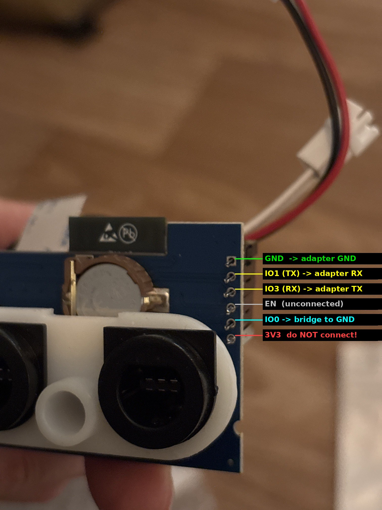
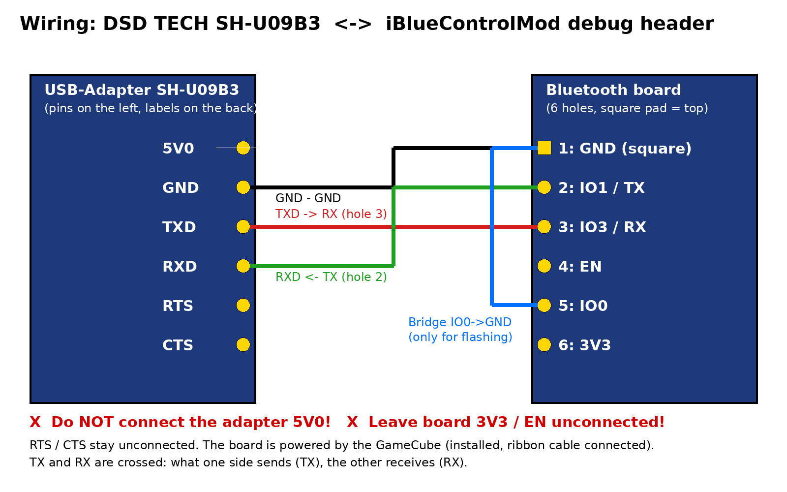

# BlueRetro for the AliExpress "iBlueControlMod" GameCube board (V1.1)

🇩🇪 **Deutsche Version:** [README.de.md](README.de.md)

Current [BlueRetro](https://github.com/darthcloud/BlueRetro) (v25.10-beta) for the
"iBlueControlMod" internal Bluetooth controller port board from AliExpress
(ESP32-WROOM-32E, 8 MB flash, PCB marking "V1.1"). The board replaces the GameCube's
controller port board, including the reset button and the clock battery.

**Support:** If this project helps you, a small donation via
[PayPal](https://www.paypal.biz/PDHBeats) is very welcome. More retro mods on my YouTube
channel [Konsolenschatz](https://www.youtube.com/@Konsolenschatz).

## Contents

* [What works (tested)](#what-works-tested)
* [Flashing over Bluetooth](#flashing-over-bluetooth)
* [Back to the stock firmware](#back-to-the-stock-firmware)
* [Reset button and sleep mode](#reset-button-and-sleep-mode)
* [GBA link](#gba-link)
* [Emergency recovery over a cable (UART)](#emergency-recovery-over-a-cable-uart)
* [How the stock firmware differs from BlueRetro](#how-the-stock-firmware-differs-from-blueretro)
* [How the port was done](#how-the-port-was-done)
* [Building](#building)

## What works (tested)

Tested on a GameCube with PicoBoot, video over the analog output.

| Feature | Result |
|---|---|
| Boot and video | ✅ |
| Flashing over Bluetooth (blueretro.io/ota.html) and going back with a 30 s reset | ✅ |
| **8BitDo GameCube Mod Kit**: detection, analog triggers, **rumble** | ✅ |
| Xbox One controller incl. rumble | ✅ |
| **Nintendo Switch 2 / NSO GameCube controller** (with the fixes from RyanCopley/BlueRetro) | ⏳ test pending |
| Rumble enabled out of the box (Advanced config → Accessories) | ⏳ test pending |
| **Sleep mode** (hold the reset button for 3 s while powering on) | ✅ |
| GBA link in sleep mode: Final Fantasy Crystal Chronicles with the GBA as controller | ✅ |
| GBA link with a BT controller: Pokémon Colosseum ↔ Pokémon LeafGreen | ✅ |

**Nintendo Switch 2 / NSO GameCube controller:** BlueRetro v25.10-beta added support for the
Switch 2 controller family, but left several bugs in it (e.g. only one NSO GameCube pad
working, a corrupt pairing key locking a pad out for good, only one BLE controller at a time,
links dropping while a second pad initialises). This build includes the fixes from
[RyanCopley/BlueRetro](https://github.com/RyanCopley/BlueRetro) (one of them originally found
by [bjerreman](https://github.com/bjerreman/BlueRetro-Switch2Fix)). The Melee-specific combo
change from that fork is not included.

Not tested separately but expected to work like regular BlueRetro: all other controllers
supported by BlueRetro (PS3/PS4/PS5, Switch Pro/Joy-Con, Wii U Pro, …), several controllers
at once and the web configuration at https://blueretro.io.

## Flashing over Bluetooth

The stock firmware contains the OTA mechanism of BlueRetro v1.9, so the official update page
works directly. You need Chrome or Edge on a PC, or Chrome on Android (Web Bluetooth).

1. Download `BlueRetro_iblue_gc.bin` from the [release](../../releases).
2. Switch off all Bluetooth controllers, switch on the console.
3. Open https://blueretro.io/ota.html, click **Connect BlueRetro** and select the
   `BlueRetro…` device.
4. Select `BlueRetro_iblue_gc.bin` and click **Update Firmware**.
   This takes a few minutes; do not switch off the console meanwhile.
5. After "OTA FW Update sucessfull!" switch the console off and on again.

If the update is interrupted, the previous firmware stays active. The new one only becomes
the boot partition after it has been verified.

**Which file?**

| File | Purpose |
|---|---|
| `BlueRetro_iblue_gc.bin` | **Regular firmware**, for everyone |
| `BlueRetro_iblue_gc_safe.bin` | Only if the board reboots or Bluetooth keeps dropping with the regular firmware: lower TX power, brownout detection off, no pairing scan during the first 20 s |
| `otadata_ota0.bin` | Only for flashing over a cable (see below) |
| `otadata_leer.bin` | Only for emergency recovery over a cable ("leer" = empty) |

The files deliberately do not contain "hw2" in their name: the update page treats the stock
firmware (version "1") as HW1 and would reject a "hw2" file with
"Hardware and firmware mismatch!".

## Back to the stock firmware

The stock firmware is never overwritten. It lives in the factory slot, BlueRetro goes into
the `ota_0` slot.

* **Hold the console reset button for 30 s** (console on). BlueRetro erases its settings and
  the boot selection, then the stock firmware starts again.
* You can flash BlueRetro again over Bluetooth at any time.

## Reset button and sleep mode

| Hold reset (console on) | Effect | Port LEDs while holding |
|---|---|---|
| short (< 3 s) | Reset the console (like the original reset button) | on |
| 3–6 s | Disconnect all BT controllers or stop the pairing scan | blink slowly |
| 6–9 s | Start the pairing scan | blink faster |
| > 9 s | Erase BlueRetro settings and pairings | blink fast |
| 30 s | Additionally go back to the stock firmware | |

**Sleep mode:** hold the reset button **while** switching on the console and release it after
about 3 s. Bluetooth turns off, the board stops driving the controller ports and the console
boots normally. Meant for accessories that don't get along with BlueRetro, e.g. the GBA as a
controller in Final Fantasy Crystal Chronicles. Use a wired original controller to play.
Back to normal: switch the console off and on again without holding the button.

## GBA link

The board only drives a controller port when a Bluetooth controller is assigned to it.
A plugged-in GBA link cable is not detected as a controller, therefore:

* **Pokémon Colosseum/XD ↔ GBA:** connect one BT controller (it gets port 1) and plug the GBA
  into another port. Don't connect another BT controller, it would take the GBA's port.
* **Final Fantasy Crystal Chronicles** and other games where every player uses a GBA:
  boot in **sleep mode**.

## Emergency recovery over a cable (UART)

Only needed if a firmware doesn't start at all and neither Bluetooth nor the reset button
respond. The bootloader and the stock firmware are not touched.

You need a USB serial adapter with **3.3 V** levels (tested: DSD TECH SH-U09B3, CP2102N) and
Chrome or Edge.

**Debug header** next to the ESP32 (6 holes, the square pad is hole 1):

| Hole | Signal | Adapter |
|---|---|---|
| 1 (square) | GND | GND |
| 2 | IO1 / TX | RXD |
| 3 | IO3 / RX | TXD |
| 4 | EN | unconnected |
| 5 | IO0 | to GND only for flashing (e.g. the metal shell of a controller port) |
| 6 | 3V3 | **unconnected**, the board is powered by the console |

The adapter's 5V0, RTS and CTS stay unconnected.

1. Console off, connect the wires, bridge IO0 to GND.
2. Switch on the console. The ESP32 starts in download mode.
3. Open https://espressif.github.io/esptool-js/, baud rate 115200, **Connect**.
   If it doesn't connect, swap TXD and RXD.
4. Flash Address **`0xd000`**, file **`otadata_leer.bin`**, **Program**.
   **Do not press "Erase Flash"**, that would also erase the stock firmware.
5. Console off, remove the IO0 bridge, console on: the stock firmware runs again.

**Reading the boot log:** same wiring without the IO0 bridge, e.g. with
https://serial.huhn.me/ at **921600 baud**. Connect the monitor first, then switch on the
console.

**Flashing BlueRetro over the cable** (instead of Bluetooth): as above, but write two files:
`otadata_ota0.bin` at `0xd000` and `BlueRetro_iblue_gc.bin` at `0x110000`.

## How the stock firmware differs from BlueRetro

The board's stock firmware (dump in
[zeus86/blueretro-gc-internal-hw2-aliexpress](https://github.com/zeus86/blueretro-gc-internal-hw2-aliexpress))
is a slightly modified **BlueRetro v1.9 / v1.9.1-beta** (2023), built with ESP-IDF v5.1.1,
app version "1". Partition table, Bluetooth configuration service and OTA are identical to
BlueRetro. The differences:

| Function | BlueRetro HW2 | iBlueControlMod |
|---|---|---|
| Console power off | IO16 | **IO17** |
| Console enable (IO13) | 20 ms pulse only when needed | **set HIGH 1 s after boot and kept high**, otherwise no video |
| Reset button (input) | IO0 | **IO16** (internal pull-up required) |
| Status LED | IO17 (PWM) | RGB LED, active low: green IO22, blue IO23, red IO18 |
| Port LEDs P1..P4 | IO2, IO4, IO12, IO15 | **IO15, IO4, IO2, IO12** |
| Reset / power sense | IO14 / IO39 | same |
| Port detection P1..P4 | IO35, IO36, IO32, IO33 | same |
| Controller data P1..P4 | IO19, IO5, IO26, IO27 | same |
| Reset button thresholds | 1 s / 3 s / 6 s | 3 s / 6 s / 9 s |
| Reset button held at power on | deep sleep | its own sleep task |

Apart from that there is only additional Chinese log output. Functionally the rest is
BlueRetro v1.9. In particular the stock firmware lacks everything BlueRetro gained since then,
for example support for the 8BitDo GameCube Mod Kit (analog triggers and rumble).

A function-by-function comparison of the stock firmware against a rebuild of the BlueRetro v1.9
source (same ESP-IDF version) found no other logic differences: the controller port driver,
the pin setup, the boot sequence, the Bluetooth init sequence and the start values of all
GameCube-related tables are identical. Only the tables for other systems (PC-FX, parallel
adapters) differ slightly, which suggests the vendor built from a commit close to, but not
exactly, the v1.9 tag.

**Why the vendor warns that BlueRetro "damages" the board:** regular BlueRetro for HW2 uses
IO17 as a blinking status LED, but on this board IO17 is the console power-off line. It also
doesn't keep IO13 high, so the console stays black. Nothing actually breaks; a 30 s reset or the
cable recovery always brings the board back.

## How the port was done

1. **Analysing the stock firmware:** the app partition was extracted from the flash dump and
   disassembled (Capstone, Xtensa). Using the text strings and the known BlueRetro v1.9 source,
   the functions were matched and the pinout above was derived.
2. **Board variant in current BlueRetro:** `CONFIG_BLUERETRO_HW2_IBLUECONTROLMOD`
   (`configs/hw2/gamecube_ibluecontrolmod`) sets the pins, the reset button on IO16 with
   pull-up, the 3/6/9 s thresholds and hotplug (a port is only driven once a BT controller is
   connected to it, which keeps ports free for the GBA).
3. **Hunting the "no video" bug:** the first builds booted, but the console stayed black.
   Bisecting test builds (no console control lines, no controller port driver, lower Bluetooth
   TX power, brownout detection off) and a rebuild of BlueRetro v1.9 with the stock pinout were
   all black as well. A function and data comparison between the stock firmware and the v1.9
   rebuild showed no difference in the program logic. Only comparing the serial boot logs of
   both firmwares revealed it: one second after start the stock firmware logs
   `POWER_ON_PIN 1` and keeps IO13 high. That is now replicated, also in sleep mode.
4. **Convenience:** rumble is enabled out of the box. After a reset the stock firmware recreates
   its configuration with rumble off, so BlueRetro switches it on once on its first boot. A
   later choice of your own is kept.
5. **OTA compatible:** the file name contains no "hw2", so blueretro.io/ota.html accepts the
   update while the stock firmware is running.

The `stockpatch/` folder also contains an older binary patch that only adds 8BitDo Mod Kit
support to the stock firmware. It is not needed with this firmware.

## Building

GitHub Actions: the "ibluecontrolmod" workflow runs on every push to `master`. Running it
manually ("Run workflow") with `release_tag` filled in (e.g. `v25.10-iblue.2`) additionally
creates a draft release with all files.

Locally (ESP-IDF 5.5):

    cp configs/hw2/gamecube_ibluecontrolmod sdkconfig
    BR_HW=_iblue BR_SYS=_gc idf.py reconfigure build
    python3 tools/ibluecontrolmod/gen_otadata_ota0.py build/otadata_ota0.bin

License: Apache-2.0 like BlueRetro. Thanks to Jacques Gagnon (darthcloud) for BlueRetro and to
zeus86 for the dump and photos of the board, to Ryan Copley and bjerreman for the Switch 2 /
NSO controller fixes.
